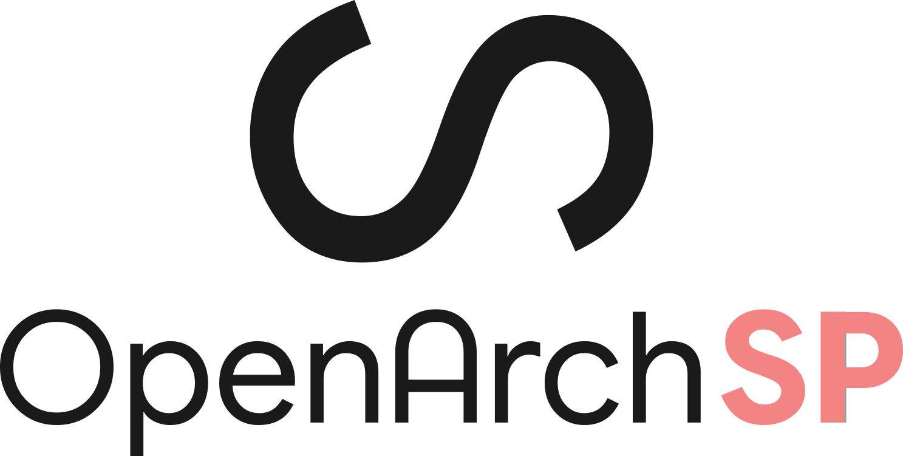

# OpenArch Swept Paths

OpenArch Swept Paths is a standalone desktop application built with Python, PySide6 (Qt), ezdxf and Shapely, with a small Rust helper for DWG conversion. The app imports DWG and DXF drawings and saves editable .oasp projects or DXF exports. GitHub Actions packages it on native Windows, macOS and Linux runners.

## Downloads

Open the repository’s Actions page and choose the latest successful Build installers run. Download the artifact for your platform and unzip it:

- **Windows x64:** Run the OpenArch Swept Paths Setup executable.
- **macOS Intel or Apple Silicon:** Open the matching disk image and drag the app into Applications. Builds are unsigned and not notarized, so macOS may require approval on first launch.
- **Linux x86_64:** Make the AppImage executable and launch it. It is built on Ubuntu 22.04 and targets compatible glibc-based distributions.

Actions artifacts are retained for 14 days. A matching version tag publishes permanent downloads under Releases. The current release is v0.2.1.

## Current workflow

1. Open a DWG or DXF site drawing as a base layer. DWG files are converted to a temporary DXF for processing; the original DWG is never modified.
2. Work in the dark CAD-style canvas. Middle-drag pans across an extended workspace beyond the drawing extents; the wheel zooms and View → Zoom to Extents reframes the imported drawing.
3. Choose a design vehicle. AP-G34-based editable axle and coupling profiles load automatically where available. Review **Source / model** and use **Edit geometry** to inspect or change the profile; the displayed length and width then come from that geometry.
4. Create named paths from the toolbar selector. Move the cursor to preview the next waypoint before clicking. The fast, lower-resolution candidate steer-axle path, swept envelope, body-edge traces, axle and wheel paths, and articulated vehicle pose update as the cursor moves. The candidate marker turns red when the model exceeds steering, path-following or articulation limits. Clicking commits a node; drag nodes after finishing to edit them. Right-click or press Enter to finish; Backspace removes the last node. Finishing runs the detailed preview in the background. Adjust turn radius, maximum road-wheel angle and steering lock-to-lock time to see the preview respond.
5. Use **Save project** (Ctrl+S on Windows) to keep the drawing, editable waypoints, vehicle profiles, path settings and positions together in an .oasp file. Use **Open** to resume editing. **Paths DXF** exports the swept paths, and **Drawing DXF** includes the background.
6. For configured vehicle geometry, the steering model follows the steer-axle path. Vehicles without geometry retain the rigid preview. The **Detailed swept path** action recalculates on demand. The Display panel controls the OASP-Outside, OASP-Vehicle and OASP-Wheel groups. Start and end articulated vehicle poses are shown by default; use **Place on route…** to add more full vehicle poses and **Remove** to delete a selected one. DXF export includes those selected poses as articulated vehicle blocks with steered wheels, and exports the layer visibility choices using green Outside, white Vehicle and red Wheel layers.
7. **Vehicle → Direction** switches between forward and reverse for the active path. Enable **Allow dry steering** to set steering while stopped. **Use minimum steer-axle radius** estimates the lead vehicle's tightest kinematic curve from its wheelbase and steering limit. The app does not model stop duration, and articulated trailer limits still need review.
8. Use **Insert waypoint** to add a node on the nearest route segment. Select nodes and press Delete to remove them; drag nodes to edit. The playback slider previews the articulated vehicle along the tracked route.
9. Select site layers in the Display panel and choose **Check clearance** for envelope intersections and nearest distance. **File → Export path analysis report…** creates an HTML summary of path metrics and available clearance results.
10. **Help → Check for Updates** checks GitHub Releases. Automatic checks can be enabled or disabled in the Help menu; available versions open the release page for the matching installer.

The source drawing is never overwritten. Saving a copy of a DWG-based project creates a DXF copy containing the converted base drawing and overlays. DXF units are read when available; unitless files default to metres and expose a drawing-units-per-metre control. DWG conversion uses bundled acadrust (MPL-2.0); see THIRD_PARTY_NOTICES.md. Conversion may not preserve every proprietary/custom object, and the viewer only displays its supported model-space entity types.

The AP-G34-23 profile set includes passenger vehicle, service vehicle, truck/bus, semi-trailer, B-double, B-triple, A-double and A-triple definitions. See [the profile source notes](docs/AP-G34-vehicle-profiles.md) for figure references and assumptions. User-edited geometry profiles are saved locally between runs.

## Model limits

Configured profiles use a low-speed, no-lateral-slip kinematic model with a pure-pursuit driver and curvature-ramped paths. Steering is rate-limited unless dry steering is enabled. It calculates forward and reverse motion, inside/outside front wheel angles, trailer motion through coupling chains, axle and wheel trajectories, body envelopes, articulation, and axle off-tracking. It displays target and actual steer-axle paths, reports path error, and flags steering saturation or an incomplete turn.

This is an early kinematic milestone, not a complete vehicle dynamics or PBS assessment tool. It does not model tyre forces, load transfer, high-speed transient response, or the position and duration of stationary steering. The minimum radius control applies the lead bicycle-model geometry; articulated combinations may need a larger radius for trailer articulation and clearance. Some lateral axle tracks and multi-trailer coupling offsets are estimated from AP-G34-23 dimension figures, and the default 35° steering stop is an OpenArch assumption. Clearance analysis checks supported CAD entities on selected layers and does not infer design intent. Review profile source notes and verify project vehicle data before design use. Austroads describes its design-vehicle library, turning templates and software parameters in [AP-G34-23](https://austroads.gov.au/publications/road-design/ap-g34); NHVR's [PBS standards](https://wws.nhvr.gov.au/road-access/performance-based-standards/the-standards) define additional assessment measures and model verification requirements.

The drawing viewer currently renders model-space LINE, LWPOLYLINE, POLYLINE, CIRCLE and ARC entities. Paper space, blocks, text and other entity types are not yet displayed.

## Development setup

Requirements: Python 3.11 or newer and a working desktop environment supported by Qt.

PowerShell:

    cd OpenArchSP
    py -m venv .venv
    .\.venv\Scripts\Activate.ps1
    python -m pip install --upgrade pip
    python -m pip install -e .
    openarchsp

On macOS or Linux, activate the environment with source .venv/bin/activate.

## Roadmap

- Populate the vehicle catalogue with verified Austroads axle, body and coupling geometry.
- Calibrate the path-following controller against Austroads paths and support measured steering behaviour for different vehicle classes.
- Add printable simulation reports and validate clearance checks against varied project drawings.
- Validate profiles and outputs against Austroads templates and jurisdictional requirements before design use.
- Broader CAD entity rendering and DWG conversion fidelity.
