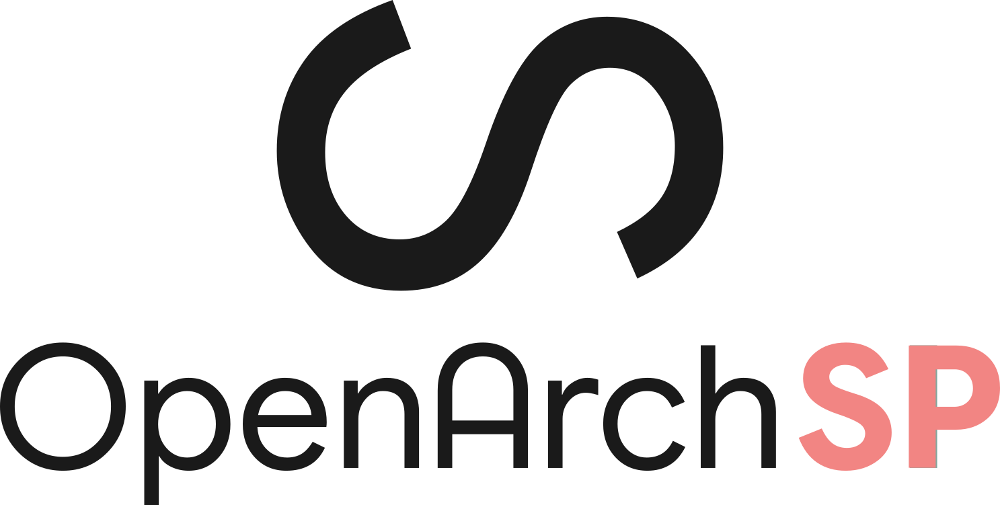

# OpenArch Swept Paths

OpenArch Swept Paths is a standalone desktop application built with Python, PySide6 (Qt), ezdxf and Shapely, with a small Rust helper for DWG conversion. The app imports DWG and DXF drawings and exports DXF. GitHub Actions packages it on native Windows, macOS and Linux runners.

## Downloads

Open the repository’s Actions page and choose the latest successful Build installers run. Download the artifact for your platform and unzip it:

- **Windows x64:** Run the OpenArch Swept Paths Setup executable.
- **macOS Intel or Apple Silicon:** Open the matching disk image and drag the app into Applications. Builds are unsigned and not notarized, so macOS may require approval on first launch.
- **Linux x86_64:** Make the AppImage executable and launch it. It is built on Ubuntu 22.04 and targets compatible glibc-based distributions.

Actions artifacts are retained for 14 days. A matching version tag publishes permanent downloads under Releases. Bump the version in pyproject.toml and push a matching tag, for example v0.1.1.

## Current workflow

1. Open a DWG or DXF site drawing as a base layer. DWG files are converted to a temporary DXF for processing; the original DWG is never modified.
2. Pan with the mouse and zoom with the wheel; use View → Zoom to Extents to reframe.
3. Choose a design vehicle. Add or verify its axle, body and coupling measurements with **Edit axle and coupling geometry** before using the kinematic model; the displayed length and width then come from that profile.
4. Draw a reference path by clicking points; right-click or press Enter to finish. Backspace undoes the last point. When a vehicle geometry profile is configured, the path represents the centre of its steer axle and waypoints are rounded into tangential turns.
5. Simulate a configured combination to display the body envelope, axle and wheel paths, steering angles, articulation and axle off-tracking. Vehicles without a geometry profile retain the simple rigid preview. Export the paths as DXF or save them into a copy of the base drawing.

The source drawing is never overwritten. Saving a copy of a DWG-based project creates a DXF copy containing the converted base drawing and overlays. The reference path is saved on OASP_STEERING_PATH and the preview boundary on OASP_SWEPT_ENVELOPE_PREVIEW. DXF units are read when available; unitless files default to metres and expose a drawing-units-per-metre control. DWG conversion uses bundled acadrust (MPL-2.0); see THIRD_PARTY_NOTICES.md. Conversion may not preserve every proprietary/custom object, and the viewer only displays its supported model-space entity types.

The initial Austroads catalogue includes passenger vehicle, service vehicle, truck/bus, semi-trailer, B-double, B-triple, A-double and A-triple definitions. Overall lengths are attributed to AP-G34-23. User-defined rigid vehicle profiles are saved locally between runs.

## Model limits

Configured profiles use a forward, low-speed, no-lateral-slip kinematic model. It calculates lead-unit steering angles (including inside/outside front wheel angles), trailer motion through arbitrary coupling chains, axle and wheel trajectories, body envelopes, articulation, and axle off-tracking. Speed and steering lock-to-lock settings are used to report the steering rate required to stay on the drawn steer-axle path; the app flags when that rate exceeds the setting.

This is the first kinematic milestone, not a complete vehicle dynamics or PBS assessment tool. It does not yet model tyre forces, load transfer, high-speed transient response, reverse manoeuvres, or steering-rate-induced deviation from the prescribed steer-axle path. The catalogue currently contains Austroads overall lengths, but not a verified axle/coupling geometry profile for every vehicle. Profiles can be entered and saved locally; the example geometry in the editor is illustrative and must be replaced with vehicle-specific dimensions before design use. Austroads describes its design-vehicle library, turning templates and software parameters in [AP-G34-23](https://austroads.gov.au/publications/road-design/ap-g34); NHVR's [PBS standards](https://wws.nhvr.gov.au/road-access/performance-based-standards/the-standards) define additional assessment measures and model verification requirements.

The drawing viewer currently renders model-space LINE, LWPOLYLINE, POLYLINE, CIRCLE and ARC entities. Paper space, blocks, text and other entity types are not yet displayed.

## Development setup

Requirements: Python 3.11 or newer and a working desktop environment supported by Qt.

PowerShell:

    cd OpenArchSP
    py -m venv .venv
    .\.venv\Scripts\Activate.ps1
    python -m pip install --upgrade pip
    python -m pip install -e .
    openarchsp

On macOS or Linux, activate the environment with source .venv/bin/activate.

## Roadmap

- Populate the vehicle catalogue with verified Austroads axle, body and coupling geometry.
- Add steering-actuator and driver path-following dynamics, including route deviation when the requested path cannot be followed.
- Add reverse manoeuvres, turning animations, clearance checks and printable simulation reports.
- Validate profiles and outputs against Austroads templates and jurisdictional requirements before design use.
- Broader CAD entity rendering and DWG conversion fidelity.
